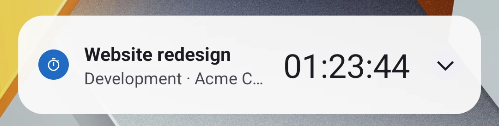
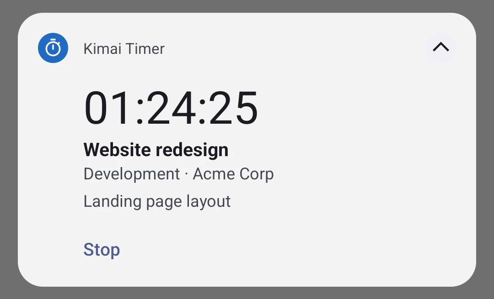

# Kimai Timer

An Android app for [Kimai](https://www.kimai.org) in two parts:

- **Kimai itself**: the app opens your Kimai's web interface, with its login, its plugins and everything else, so it
  replaces Kimai's web app installed from the browser. Links to other sites open in the browser, exports go to
  Downloads, file fields open Android's file picker.
- **The running timer in a notification, also on the lock screen**: a clock ticking in HH:MM:SS with project,
  activity, customer and description, and a Stop button. After a stop from the notification, the card offers Restart
  for 15 minutes. Tapping it opens Kimai in the app.





Timers started or stopped anywhere else (the web pages, another app, the API) show up on the phone within a second
or two, with the Kimai plugin [AppPushBundle](https://github.com/6801318d8d/AppPushBundle) installed. Without it, the
app checks every 15 minutes.

## Download

The APK is attached to each [release](https://github.com/6801318d8d/kimai-timer/releases). Android 12 or newer.

## Setup

1. In Kimai, create an API token: your profile → API access.
2. At the first start the app opens its settings: enter the Kimai address and the token, then "Save and connect", and
   allow notifications. Going back shows Kimai: log in there once (tick "remember me" to stay logged in).
3. On Xiaomi/HyperOS phones also turn on Autostart and allow the notifications on the lock screen (App settings).

Settings later: long press on the app icon → Settings. The token (for the notification) and the login session (for
the web interface) stay in the app's private storage; the app talks only to your Kimai.

Downloads that the web page starts with a form (POST) or from JavaScript cannot go through Android's download manager:
for those, open Kimai in the browser.

## How changes made elsewhere arrive

Chosen in the app, under "Timers started or stopped elsewhere arrive":

- **Automatically** (default): UnifiedPush if a distributor app is installed and works, else the direct connection.
- **UnifiedPush**: through a [UnifiedPush](https://unifiedpush.org) distributor app (ntfy, NextPush, Sunup...),
  which keeps the phone's one push connection: the lightest on the battery. Kimai sends a message that only says
  "your timesheets changed", and the app reads the timer from the API. Apps' own embedded distributors are left out;
  with more than one distributor, "UnifiedPush distributor" chooses.
- **Direct connection**: the app keeps Kimai's event stream open in a foreground service, so its notification stays
  even when no timer runs ("No timer running", with the latest entry and Restart). Allow it in the background
  (battery optimisation) so the system does not close it.
- **Every 15 minutes only**.

The 15-minute check runs in every mode as a safety net, and brings the direct connection back if the system closed
it. Buttons pressed while offline are sent when the network is back.

### Setup over adb

To configure a phone from a computer without typing the token on it (only the adb shell can send this broadcast:
the receiver requires `android.permission.DUMP`):

```sh
adb shell am broadcast -n io.github.x6801318d8d.kimaitimer/.SetupReceiver --es url https://kimai.example.com --es token <token> [--es mode auto|unifiedpush|direct|periodic]
adb shell am start -S -n io.github.x6801318d8d.kimaitimer/.MainActivity
```

## Build

JDK 17 or newer (tested with 25) and the Android SDK with platform 36:

```sh
./gradlew lintDebug assembleRelease
```

The release APK is `app/build/outputs/apk/release/app-release.apk` (about 680 KB, minified). It is signed with the
key described in `signing/keystore.properties` (`storeFile`, `storePassword`, `keyAlias`, `keyPassword`; not in
git), or with the debug key when that file is missing.

Dependencies: AndroidX Core and WorkManager, and the UnifiedPush connector (which brings Tink for Web Push
decryption; AppPushBundle's messages carry no data and arrive unencrypted).

## Code

| File | Role |
| --- | --- |
| `MainActivity.kt` | Kimai's web interface (WebView): login, links, downloads, file picker, back navigation |
| `SettingsActivity.kt` | Settings and status screen |
| `TimerNotification.kt` | The notification, one layout for every state: running, stopping, starting, stopped, idle |
| `SyncWorker.kt` | All API calls, in the background: refresh, Stop, Restart, endpoint registration |
| `Delivery.kt` | The modes: picks UnifiedPush or the direct connection and starts or stops them |
| `PushService.kt` | UnifiedPush endpoint and messages |
| `StreamService.kt` | The direct connection (foreground service, type specialUse) |
| `KimaiApi.kt` | Kimai's REST API and AppPushBundle |
| `ActionReceiver.kt`, `BootReceiver.kt`, `SetupReceiver.kt` | Notification buttons and redraws; boot and update; setup over adb |

Android's Chronometer formats MM:SS below one hour and H:MM:SS above, so the leading zeros go in its format string
("00:%s", "0%s", "%s") and an exact, non-wakeup alarm redraws the notification at the 1 h and 10 h marks.

## License

MIT. The timer icon is Google's Material Icons "timer" (Apache License 2.0).
